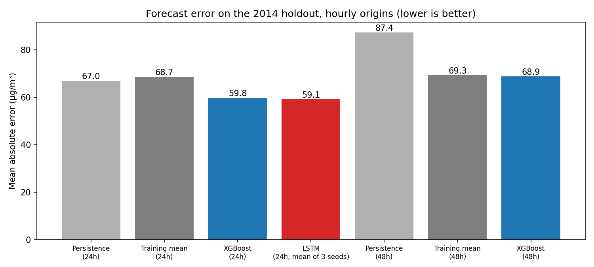
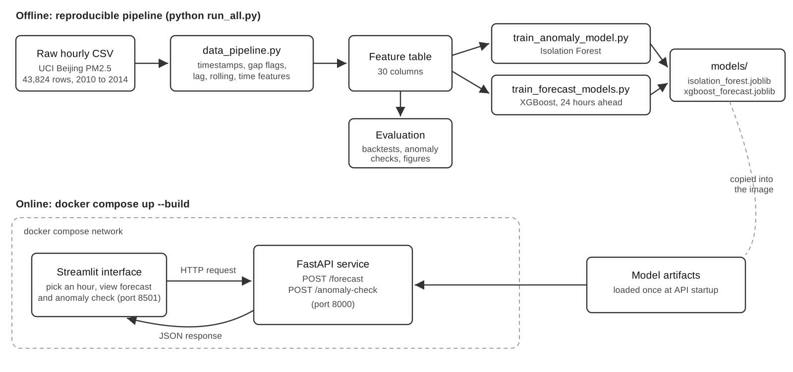

# Air quality anomaly detection and short-term forecasting

DSA 8401 Applied Machine Learning, capstone project
Linda Chebet Kiplagat (224685), MSc Data Science and Analytics, Strathmore University

## Project overview

Most urban air quality dashboards report the current pollutant concentration and nothing about the next day. This project builds an end-to-end system that takes an hourly PM2.5 reading with its recent history and returns two things: a forecast of PM2.5 24 hours ahead, and a check on whether the reading is anomalous relative to the historical record.

The system is trained on the [Beijing PM2.5 dataset](https://archive.ics.uci.edu/dataset/381/beijing+pm2+5+data) from the UCI Machine Learning Repository (43,824 hourly observations, 2010 to 2014, of which 2,067 PM2.5 readings are missing). The motivating context is cities such as Nairobi, where monitoring records are much shorter. The models are calibrated for the Beijing monitor only and would need local data before any use elsewhere.

The full write-up is in [`report/DSA8401_Capstone_Report_224685.docx`](report/DSA8401_Capstone_Report_224685.docx).

## Headline results

All figures are from the final 365 days of the data (2014), which no model saw during training. They are regenerated by `python run_all.py` and stored in `data/processed/*.json`.

| Forecast, 24 hours ahead (8,371 hourly origins) | MAE (µg/m³) | RMSE (µg/m³) |
|---|---|---|
| Persistence (PM2.5 stays at its current level) | 66.9 | 98.0 |
| Training mean | 69.1 | 93.5 |
| XGBoost (deployed) | 60.1 | 83.6 |
| LSTM (mean of three seeds, not deployed) | 59.1 | 81.2 |

| Forecast on daily origins (357 origins) | MAE (µg/m³) | RMSE (µg/m³) |
|---|---|---|
| SARIMA | 72.2 | 107.0 |
| Persistence | 70.6 | 105.1 |
| XGBoost | 64.0 | 91.8 |

What the results mean:

- XGBoost is about 10% more accurate than persistence at 24 hours. The gain is real (95% interval for the MAE difference: 2.5 to 11.7 µg/m³) but modest against a holdout mean of 98 µg/m³.
- The LSTM is slightly ahead of XGBoost, but the difference is within noise (0.98 µg/m³, 95% interval -0.32 to 2.29). XGBoost is deployed because it gives the same accuracy with a much lighter container and a simpler request.
- At 48 hours XGBoost (MAE 68.9) is no better than predicting the training mean (69.3). The system therefore serves a 24-hour forecast only.
- SARIMA is worse than persistence on this series.
- The Isolation Forest flags sustained very high pollution (92% of hours above 500 µg/m³) but misses sudden changes: it flags 8 of the 102 real one-hour rises of 100 µg/m³ or more. It is a severity detector, not a change detector.



## Architecture



The offline pipeline turns the raw CSV into a feature table, trains both models and writes them to `models/`. The online part is two containers: a FastAPI service that loads the models at startup, and a Streamlit interface that calls it.

## Repository layout

```
run_all.py                     runs the whole pipeline in order
src/data_pipeline.py           raw CSV -> cleaned, engineered feature table
src/train_anomaly_model.py     Isolation Forest -> models/isolation_forest.joblib
src/train_forecast_models.py   SARIMA vs XGBoost (15 origins) -> models/xgboost_forecast.joblib
src/backtest_forecast.py       XGBoost vs baselines, one-year holdout, alert cut-offs
src/backtest_sarima.py         SARIMA vs XGBoost vs persistence, daily origins
src/backtest_horizons.py       24-hour and 48-hour horizons compared
src/backtest_lstm.py           LSTM vs XGBoost vs persistence
src/evaluate_anomaly_model.py  anomaly episodes, sensitivity, synthetic and real spike tests
src/eval_utils.py              block bootstrap for differences in MAE
src/feature_utils.py           feature encoding shared with the API
src/make_sample_data.py        sample readings for the interface
src/make_plots.py              figures in docs/
api/                           FastAPI service (main.py, schemas.py)
app/streamlit_app.py           Streamlit interface
tests/test_api.py              API smoke tests
.github/workflows/             GitHub Actions: builds the containers and tests the API
models/                        serialised model artifacts
data/raw/                      raw UCI CSV
data/processed/                results (JSON); large CSVs are rebuilt, not committed
docs/                          architecture diagram and figures
report/                        final report
Dockerfile, Dockerfile.ui, docker-compose.yml
```

## Setup

Requirements: Python 3.12 or 3.13, and Docker with Docker Compose for the deployment step.

```bash
git clone <repository-url>
cd <repository-folder>
python -m venv .venv
source .venv/bin/activate          # Windows: .venv\Scripts\activate
pip install -r requirements.txt
```

The raw data file is included at `data/raw/PRSA_data_2010_1_1-2014_12_31.csv`. If it is missing, download it from the [UCI repository page](https://archive.ics.uci.edu/dataset/381/beijing+pm2+5+data) and place it there.

## How to reproduce

```bash
python run_all.py            # full run, about two to three minutes on a laptop
python run_all.py --quick    # skips the SARIMA backtest and the LSTM test
```

This runs, in order: the data pipeline, anomaly model training, forecast model training, the four backtests, the anomaly evaluation, the sample data and the figures. It rewrites `models/`, `data/processed/` and the figures in `docs/`.

Random seeds are fixed. The XGBoost, SARIMA and Isolation Forest results reproduce exactly with the pinned package versions. The LSTM results reproduced exactly across repeated runs on one machine, and may differ in the first decimal place on other hardware or PyTorch builds.

To run the API tests (they need the model files in `models/`):

```bash
pytest -q
```

## Deployment

```bash
docker compose up --build
```

- API: http://localhost:8000 (interactive documentation at http://localhost:8000/docs)
- Interface: http://localhost:8501

The interface starts once the API reports healthy. Stop both with `docker compose down`.

Example request:

```bash
curl -X POST http://localhost:8000/forecast \
  -H "Content-Type: application/json" \
  -d '{"timestamp": "2014-12-30T12:00:00", "hour": 12, "month": 12,
       "pm25": 180.0, "dew_point": -5.0, "temp": 2.0, "pressure": 1020.0,
       "wind_speed": 3.5, "snow_hours": 0, "rain_hours": 0, "wind_dir": "NW",
       "pm25_lag_1h": 175.0, "pm25_lag_3h": 160.0, "pm25_lag_24h": 140.0,
       "pm25_roll_mean_6h": 165.0, "pm25_roll_std_6h": 12.0,
       "pm25_roll_mean_24h": 150.0, "pm25_roll_std_24h": 20.0}'
```

The response has the form `{"forecast_horizon_hours": 24, "predicted_pm25": <value>, "origin_timestamp": "2014-12-30T12:00:00"}`. Send the same body to `/anomaly-check` for the anomaly flag and score. Invalid readings (negative concentrations, an unknown wind direction, or an hour or month that disagrees with the timestamp) are rejected with status 422.

To run without Docker:

```bash
uvicorn api.main:app --port 8000
streamlit run app/streamlit_app.py     # in a second terminal
```

## Continuous integration

Every push to the repository runs the workflow in `.github/workflows/docker-build.yml` on GitHub's servers. It builds both images, starts them with Docker Compose, waits for the health checks, sends a forecast request, an anomaly request and an invalid request to the API, and checks that the interface responds. The result of each run is on the repository's **Actions** tab.

The workflow checks that the system builds and answers requests. It does not retrain the models or check their accuracy; `python run_all.py` does that.

To try the system without installing Docker locally, open the repository in GitHub Codespaces (**Code**, then **Codespaces**, then **Create codespace**) and run `docker compose up --build` in its terminal.

## Endpoints

| Method | Path | Purpose |
|---|---|---|
| GET | `/` | service description |
| GET | `/health` | confirms both models are loaded |
| POST | `/forecast` | PM2.5 forecast 24 hours after the reading |
| POST | `/anomaly-check` | anomaly flag, score and a plain-language interpretation |

## Limitations

- The models are trained on one monitor in Beijing and are not valid for another city without retraining on local data.
- The forecast improves on persistence by about 10% only, and an alert at 150 µg/m³ catches about three in ten of the hours above that level.
- The caller supplies the lag and rolling features. A production service would build them from a stored stream of readings.
- The anomaly detector was fitted on the full record, including 2014, and has no ground-truth labels to be scored against.
- Hyperparameters are sensible defaults and were not tuned.

The report discusses each of these.

## Data and licence

Chen, S. (2015). *Beijing PM2.5* [Dataset]. UCI Machine Learning Repository. https://doi.org/10.24432/C5JS49. Licensed under CC BY 4.0.

## AI use

See [`AI_USE.md`](AI_USE.md).
